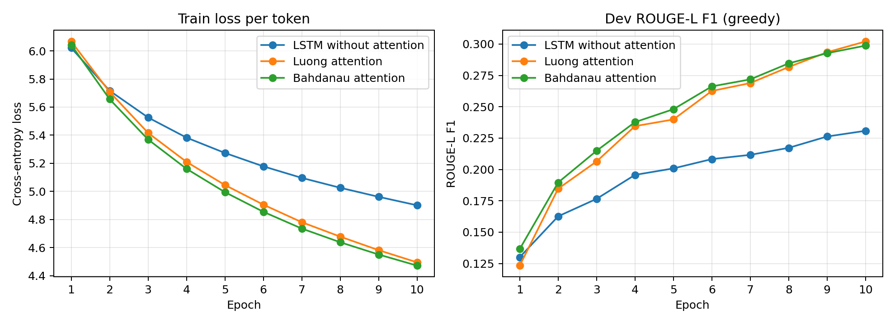

# Báo cáo kết quả hệ thống dịch máy Anh Việt bằng Encoder Decoder LSTM

## 1. Tổng quan kết quả

Hệ thống so sánh ba mô hình dịch máy từ tiếng Anh sang tiếng Việt: Encoder–Decoder LSTM không attention, LSTM với Luong attention và LSTM với Bahdanau attention. Cả ba mô hình đã hoàn thành 10 epoch trong lần chạy được ghi nhận tại [results/results.log](results/results.log).

Luong đạt kết quả cao nhất trong lần chạy này với ROUGE-L F1 trên test bằng **0,3164**, tiếp theo là Bahdanau với **0,3128** và mô hình không attention với **0,2350**. Hai mô hình attention đều cải thiện rõ so với mô hình cơ sở. Tuy nhiên, chênh lệch giữa Luong và Bahdanau nhỏ; kết quả của một lần chạy chưa đủ để khẳng định Luong luôn tốt hơn.

## 2. Dữ liệu và cấu hình

### 2.1. Xử lý dữ liệu

Dữ liệu sử dụng là ba file `small-train.json`, `small-dev.json` và `small-test.json` trong thư mục [data](data/). Mỗi mẫu gồm một câu tiếng Anh và một câu tiếng Việt.

Quy trình tiền xử lý trong [src/preprocessing.py](src/preprocessing.py) gồm loại BOM, chuẩn hóa Unicode NFC, chuyển chữ thường và tách token theo khoảng trắng. Chỉ giữ cặp có độ dài từ 1 đến 50 token ở cả hai phía, trước khi thêm BOS/EOS; không cắt cụt câu để đạt giới hạn này.

| Tập dữ liệu | Số cặp ban đầu | Số cặp sau lọc với ngưỡng 50 token |
|---|---:|---:|
| Train | 20.000 | 18.607 |
| Dev | 2.000 | 1.901 |
| Test | 2.000 | 1.786 |

Hai ngôn ngữ có vocabulary riêng, chỉ xây từ train sau lọc. Cả ba mô hình dùng chung các vocabulary này. Nguồn được thêm EOS; đích được thêm BOS ở đầu và EOS ở cuối. Batch được đệm bằng PAD, đồng thời giữ độ dài thật của câu nguồn để encoder dùng packing. Các câu tham chiếu phục vụ đánh giá giữ nguyên token đã chuẩn hóa, không thay từ ngoài vocabulary thành UNK.

### 2.2. Cấu hình triển khai

Log xác nhận môi trường **PyTorch 2.11.0+cu130**, thiết bị **CUDA**, và 10 epoch cho mỗi mô hình. Các siêu tham số dưới đây lấy từ mặc định của [src/main.py](src/main.py) và [src/engine.py](src/engine.py). Log chưa lưu toàn bộ đối số dòng lệnh nên cần đối chiếu nếu lần chạy đã ghi đè các giá trị mặc định.

| Thành phần | Cấu hình mặc định trong source |
|---|---|
| Encoder | LSTM một chiều, 3 lớp |
| Decoder | LSTM, 3 lớp |
| Hidden size | 256 |
| Embedding size | 256 |
| Dropout | 0,3 |
| Optimizer | Adam |
| Learning rate | 0,001 |
| Batch size | 32 |
| Teacher forcing ratio khi train | 0,5 |
| Gradient clipping | Max norm 1,0 |
| Số epoch | 10 |
| Giới hạn vocabulary | Tối đa 10.000 token mỗi ngôn ngữ, tính cả 4 token đặc biệt |
| Tần suất tối thiểu để vào vocabulary | 2 |
| Seed | 42 |
| Giải mã | Greedy; tối đa 51 bước gồm cơ hội sinh EOS |

Giới hạn vocabulary là mức tối đa. Khi dựng lại vocabulary từ dữ liệu train cục bộ theo cấu hình trên, vocabulary tiếng Anh có **8.943 token** và tiếng Việt có **4.003 token**, đã tính cả 4 token đặc biệt. Hai kích thước này khớp với ma trận embedding trong cả ba checkpoint tại `checkpoint/`. Seed được đặt lại và train DataLoader được tạo mới cho từng mô hình để cùng bắt đầu từ thứ tự batch xác định bởi seed.

## 3. Kiến trúc và phương pháp đánh giá

### 3.1. Ba kiến trúc

- **Không attention (`none`):** encoder truyền cả hidden state và cell state cuối sang decoder. Decoder không truy cập trực tiếp toàn bộ chuỗi đầu ra encoder trong từng bước sinh.
- **Luong (`luong`):** dùng global-general attention với query sau khi LSTM decoder cập nhật. Vector kết hợp context và decoder output được đưa vào bước tiếp theo theo cơ chế input-feeding.
- **Bahdanau (`bahdanau`):** dùng additive attention với query là hidden state trước bước cập nhật decoder. Context được nối với embedding để đưa vào LSTM.

Hai mô hình attention đều che vị trí PAD trước softmax. Cấu trúc chi tiết nằm trong [src/model.py](src/model.py).

### 3.2. Huấn luyện và chọn checkpoint

Loss huấn luyện là cross-entropy, bỏ qua PAD và được báo cáo theo token đích thực. Sau mỗi epoch, hệ thống đánh giá trên dev bằng câu dịch tự sinh. Checkpoint được chọn theo ROUGE-L F1 dev cao nhất; nếu bằng nhau, chọn dev-NLL thấp hơn.

Sau khi hoàn tất huấn luyện, trọng số tốt nhất được ghi vào `{mode}.pt`. Chương trình nạp lại đúng file này trước khi đánh giá test. Trong log hiện có, checkpoint tốt nhất của cả ba mô hình đều thuộc **epoch 10**. Việc ghi file diễn ra ở cuối `fit()`, nên checkpoint của lần chạy chỉ được bảo đảm tồn tại sau khi hàm hoàn tất.

### 3.3. Các độ đo

- **ROUGE-L F1:** độ đo chính, thang 0–1, lấy trung bình theo câu; dùng tokenizer giữ dấu tiếng Việt và không stemming. Giá trị 0,3164 không có nghĩa là 31,64% số câu được dịch đúng hoàn toàn.
- **ROUGE-L precision và recall:** cũng được lấy trung bình theo câu; giúp mô tả thêm độ khớp giữa câu sinh và tham chiếu.
- **BLEU:** độ đo bổ sung, thang 0–100, tính ở mức corpus bằng SacreBLEU với `tokenize='none'`.

ROUGE-L và BLEU đều tính trên câu sinh bằng greedy, không đưa token đích đúng vào nhánh giải mã này. Dev-NLL được tính riêng bằng teacher forcing, nên không được xem là điểm chất lượng của câu tự sinh.

### 3.4. Số lượng tham số

Số tham số được tính trực tiếp từ [src/model.py](src/model.py) với embedding size 256, hidden size 256, encoder và decoder đều có 3 lớp LSTM, vocabulary nguồn 8.943 và vocabulary đích 4.003. Đã nạp từng checkpoint `none.pt`, `luong.pt`, `bahdanau.pt` trong `checkpoint/` vào mô hình tương ứng bằng `load_state_dict(..., strict=True)` để kiểm tra toàn bộ tên và kích thước tensor. Tổng `sum(p.numel() for p in model.parameters())` khớp với tổng số phần tử trong từng checkpoint.

| Thành phần | Không attention | Luong | Bahdanau |
|---|---:|---:|---:|
| Embedding encoder (`encoder.emb`) | 2.289.408 | 2.289.408 | 2.289.408 |
| LSTM encoder (`encoder.rnn`) | 1.579.008 | 1.579.008 | 1.579.008 |
| Embedding decoder (`decoder.emb`) | 1.024.768 | 1.024.768 | 1.024.768 |
| LSTM decoder (`decoder.rnn`) | 1.579.008 | 1.841.152 | 1.841.152 |
| Attention (`decoder.attn`) | 0 | 65.536 | 131.328 |
| Kết hợp context và decoder (`decoder.fuse`) | 0 | 131.328 | 131.328 |
| Lớp đầu ra (`decoder.head`) | 1.028.771 | 1.028.771 | 1.028.771 |
| **Tổng tham số** | **7.500.963** | **7.959.971** | **8.025.763** |

Tất cả tensor tham số của ba mô hình đều có `requires_grad=True`, nên tổng tham số có thể huấn luyện bằng tổng tham số trong bảng. Phép đếm bao gồm hàng PAD của embedding theo kích thước tensor, dù `padding_idx=0` khiến hàng này không nhận gradient từ phép tra cứu embedding. Dropout, masking và softmax không có tham số học được; embedding đích và lớp đầu ra không chia sẻ trọng số.

Cách tính từng thành phần:

- **Embedding:** `V × E`, lần lượt là `8.943 × 256` và `4.003 × 256`.
- **Một lớp LSTM một chiều:** `4H × I + 4H × H + 8H = 4H(I + H + 2)`, với `I` là kích thước đầu vào và `H` là hidden size. Công thức tính cả hai vector bias `bias_ih` và `bias_hh`.
- **Encoder và decoder không attention:** cả ba lớp đều có `I = H = 256`, tổng mỗi khối là `3 × 4 × 256 × (256 + 256 + 2) = 1.579.008`.
- **Decoder có attention:** lớp đầu nhận embedding nối với context hoặc vector input-feeding nên `I = 512`; hai lớp còn lại có `I = 256`. Tổng là `4 × 256 × (512 + 256 + 2) + 2 × 4 × 256 × (256 + 256 + 2) = 1.841.152`.
- **Luong attention:** một ma trận không bias, `H² = 65.536`. **Bahdanau attention:** hai ma trận và một vector không bias, `2H² + H = 131.328`.
- **Lớp fuse:** ánh xạ `2H → H` có bias, `2H² + H = 131.328`.
- **Lớp đầu ra:** ánh xạ `H → V_vi` có bias, `(H + 1) × V_vi = 257 × 4.003 = 1.028.771`.

So với mô hình không attention, Luong thêm **459.008** tham số và Bahdanau thêm **524.800** tham số. Phần tăng bao gồm đầu vào LSTM decoder rộng hơn, lớp fuse và bộ attention. Bahdanau nhiều hơn Luong **65.792** tham số. Các số này được bổ sung bằng cách kiểm tra source và checkpoint cục bộ; log huấn luyện ban đầu chưa ghi số tham số.

## 4. Kết quả thực nghiệm

### 4.1. Kết quả tại checkpoint được chọn

Số liệu dev lấy từ dòng epoch tương ứng trong log; số liệu test lấy từ phần `Mode: ...` sau khi checkpoint đã được nạp lại. Giá trị trong bảng được làm tròn, còn log giữ độ chính xác gốc của kết quả test.

| Mô hình | Best epoch | ROUGE-L F1 dev | ROUGE-L F1 test | BLEU dev | BLEU test |
|---|---:|---:|---:|---:|---:|
| Không attention | 10 | 0,2308 | 0,2350 | 2,30 | 2,6231 |
| Luong attention | 10 | **0,3021** | **0,3164** | **4,94** | **6,0928** |
| Bahdanau attention | 10 | 0,2988 | 0,3128 | 4,61 | 5,5817 |

| Mô hình | ROUGE-L precision test | ROUGE-L recall test |
|---|---:|---:|
| Không attention | 0,2615 | 0,2165 |
| Luong attention | **0,3454** | **0,2961** |
| Bahdanau attention | 0,3383 | 0,2953 |

BLEU signature của cả ba mô hình trong log giống nhau:

```text
nrefs:1|case:mixed|eff:no|tok:none|smooth:exp|version:2.6.0
```

### 4.2. Diễn biến train loss

| Epoch | Không attention | Luong | Bahdanau |
|---|---:|---:|---:|
| 1 | 6,0212 | 6,0672 | 6,0429 |
| 2 | 5,7165 | 5,7076 | 5,6560 |
| 3 | 5,5260 | 5,4163 | 5,3694 |
| 4 | 5,3827 | 5,2101 | 5,1609 |
| 5 | 5,2735 | 5,0454 | 4,9946 |
| 6 | 5,1782 | 4,9056 | 4,8546 |
| 7 | 5,0960 | 4,7807 | 4,7354 |
| 8 | 5,0257 | 4,6781 | 4,6380 |
| 9 | 4,9613 | 4,5816 | 4,5507 |
| 10 | 4,9010 | 4,4950 | 4,4717 |

### 4.3. Diễn biến ROUGE-L F1 trên dev

| Epoch | Không attention | Luong | Bahdanau |
|---|---:|---:|---:|
| 1 | 0,1300 | 0,1234 | 0,1366 |
| 2 | 0,1627 | 0,1847 | 0,1896 |
| 3 | 0,1766 | 0,2064 | 0,2149 |
| 4 | 0,1957 | 0,2346 | 0,2378 |
| 5 | 0,2009 | 0,2399 | 0,2481 |
| 6 | 0,2083 | 0,2626 | 0,2662 |
| 7 | 0,2117 | 0,2689 | 0,2718 |
| 8 | 0,2173 | 0,2817 | 0,2846 |
| 9 | 0,2263 | 0,2935 | 0,2927 |
| 10 | 0,2308 | 0,3021 | 0,2988 |

### 4.4. Đồ thị huấn luyện



Hình bên trái thể hiện cross-entropy train theo token; hình bên phải thể hiện ROUGE-L F1 dev từ câu sinh bằng greedy. Đồ thị được xuất bởi [src/plotting.py](src/plotting.py) và khớp xu hướng của số liệu trong log.

## 5. Phân tích kết quả

### 5.1. Hai mô hình attention cải thiện so với mô hình cơ sở

Luong tăng ROUGE-L F1 test từ 0,23498 lên 0,31640, tương ứng tăng tuyệt đối khoảng **0,0814** và tăng tương đối khoảng **34,65%**. Bahdanau tăng tuyệt đối khoảng **0,0779**, tương đương tăng tương đối **33,13%** so với mô hình không attention. Các tỷ lệ này mô tả mức tăng của độ đo, không phải tỷ lệ số câu được dịch đúng.

Kết quả phù hợp với khác biệt kiến trúc: attention cho phép decoder khai thác các trạng thái encoder tại từng bước sinh, trong khi mô hình cơ sở phụ thuộc vào các trạng thái cuối được truyền sang decoder. Tuy nhiên, hai mô hình attention cũng có thêm tham số; thí nghiệm hiện tại chưa tách riêng ảnh hưởng của cơ chế attention khỏi ảnh hưởng của số tham số.

### 5.2. Luong và Bahdanau có kết quả gần nhau

Luong cao hơn Bahdanau khoảng **0,0036 ROUGE-L F1 test** và **0,5111 BLEU test**. Bahdanau có ROUGE-L dev cao hơn Luong trong 8 epoch đầu, nhưng Luong vượt lên ở epoch 9 và 10. Vì vậy, kết luận từ các epoch đầu có thể khác với kết quả sau khi hoàn tất huấn luyện.

Ở epoch cuối, Bahdanau có train loss thấp hơn Luong, nhưng ROUGE-L dev và test lại thấp hơn một chút. Điều này cho thấy không nên chỉ dựa vào train loss để chọn mô hình; tiêu chí lựa chọn checkpoint cần bám vào chất lượng câu tự sinh trên dev.

Thí nghiệm chỉ ghi nhận một seed và chưa có khoảng tin cậy hoặc kiểm định thống kê. Do đó, có thể kết luận Luong tốt nhất **trong lần chạy này**, chưa thể khẳng định ưu thế ổn định trên các lần chạy khác.

### 5.3. Mô hình vẫn cải thiện ở cuối lịch huấn luyện

Loss giảm và ROUGE-L dev tăng qua cả 10 epoch ở cả ba mô hình. Từ epoch 1 đến 10, train loss giảm khoảng 18,60% với mô hình không attention, 25,91% với Luong và 26,00% với Bahdanau.

Chưa quan sát thấy ROUGE-L dev suy giảm trong khoảng đã chạy. Tuy nhiên, dữ liệu này chưa đủ để khẳng định mô hình đã hội tụ hoặc hoàn toàn không có overfitting. Điểm test cao hơn dev một chút cũng không tự chứng minh có lỗi: đây là hai tập câu khác nhau.

### 5.4. Chất lượng dịch còn hạn chế

Dù attention giúp tăng điểm, BLEU test cao nhất mới đạt 6,0928 và ROUGE-L F1 test cao nhất là 0,3164. Các điểm này cho thấy mức khớp với bản dịch tham chiếu còn hạn chế; chưa đủ cơ sở để đánh giá hệ thống dịch tốt trong sử dụng thực tế.

Log chưa chứa câu nguồn, bản dịch tham chiếu và câu dự đoán. Vì vậy, chưa thể xác định lỗi chủ yếu là thiếu ý, sai từ, lặp từ, sinh câu quá ngắn hay gặp nhiều UNK. Các nguyên nhân này cần được kiểm tra bằng mẫu dịch thực tế, không suy ra trực tiếp từ một điểm tổng hợp.

## 6. Cảnh báo SacreBLEU

Log lặp lại cảnh báo về các dòng kết thúc bằng dấu chấm đã tách token. Đây là kiểm tra của SacreBLEU khi phát hiện ít nhất 100 câu dự đoán kết thúc bằng `" ."`; từ “test” trong thông báo là nội dung chung của thư viện, không có nghĩa chương trình đang dùng tập test trong từng epoch. Nguồn đối chiếu: [mã nguồn SacreBLEU](https://github.com/mjpost/sacrebleu/blob/master/sacrebleu/metrics/base.py).

Trong triển khai hiện tại, cả dự đoán và tham chiếu được chấm trên token, với `tokenize='none'`. Các điểm BLEU trong báo cáo cần được hiểu theo đúng quy ước này; không so sánh trực tiếp với kết quả dùng cách token hóa khác mà không đối chiếu BLEU signature. Cảnh báo không làm thay đổi cách tính ROUGE-L.

Nếu tiếp tục giữ cách chấm hiện tại, có thể dùng `BLEU(tokenize='none', lowercase=False, force=True)` để bỏ cảnh báo. Tùy chọn `force=True` chỉ bỏ kiểm tra cảnh báo này, không tự detokenize hay làm tăng điểm.

## 7. Phần cần bổ sung để hoàn thiện phân tích

Các kết quả hiện có đủ để so sánh định lượng ba mô hình theo ROUGE-L và BLEU. Để hoàn thiện báo cáo theo yêu cầu bài thực hành, cần bổ sung ba câu dịch mẫu có nhận xét cho mỗi mô hình và heatmap attention của ba câu cho Bahdanau. Không tạo ví dụ giả để thay cho đầu ra của checkpoint đã huấn luyện.

Số tham số đã được bổ sung và đối chiếu với checkpoint ở mục 3.4. Log vẫn chưa ghi thời gian mỗi epoch, cấu hình dòng lệnh đầy đủ hoặc nhiều lần chạy với seed khác nhau. Vì vậy, dù mô hình không attention có ít tham số nhất, báo cáo chưa đủ dữ liệu để so sánh thời gian chạy hoặc bộ nhớ thực tế, cũng chưa đánh giá độ ổn định của chênh lệch kết quả. Nên lưu thêm các trường này cùng số tham số, vocabulary và cấu hình checkpoint cho các lần chạy tiếp theo.

## 8. Kết luận và bảng tổng hợp

Trong lần chạy 10 epoch đã ghi nhận, cả Luong và Bahdanau đều vượt mô hình không attention. Luong có ROUGE-L F1 test cao nhất, nhưng chỉ nhỉnh hơn Bahdanau một khoảng nhỏ. Kết quả chứng minh lợi ích thực nghiệm của hai biến thể attention so với mô hình cơ sở trong thiết lập này; chất lượng dịch cụ thể vẫn cần được đánh giá thêm bằng câu mẫu và heatmap.

| Mô hình | ROUGE-L dev | ROUGE-L test | Số tham số |
|---|---:|---:|---:|
| Không attention | 0,2308 | 0,2350 | 7.500.963 |
| Bahdanau | 0,2988 | 0,3128 | 8.025.763 |
| Luong | **0,3021** | **0,3164** | 7.959.971 |
